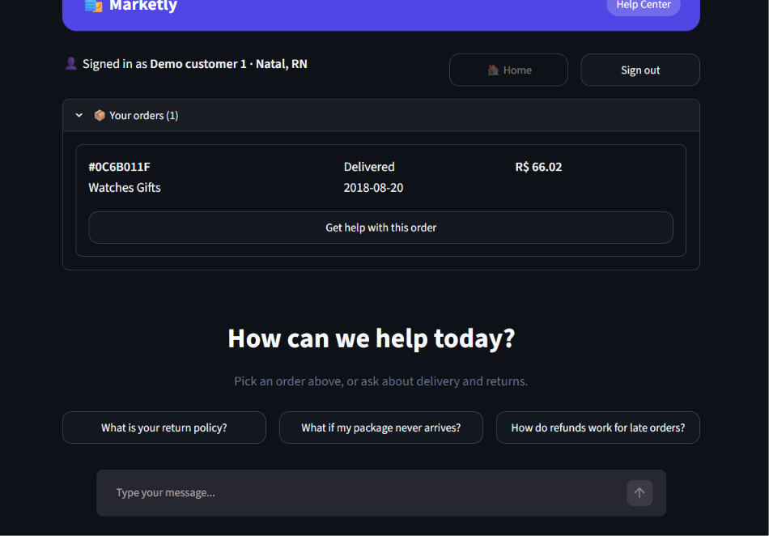
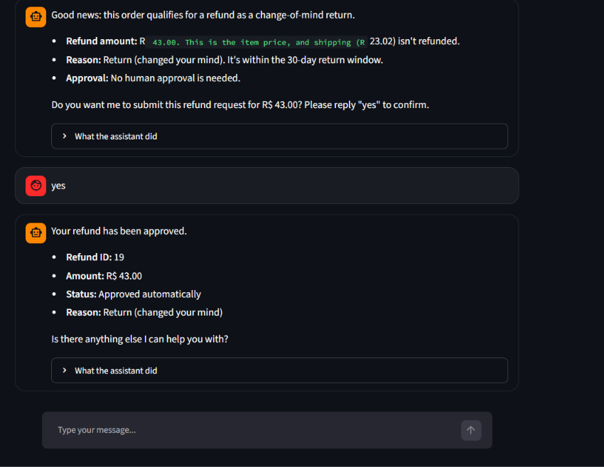
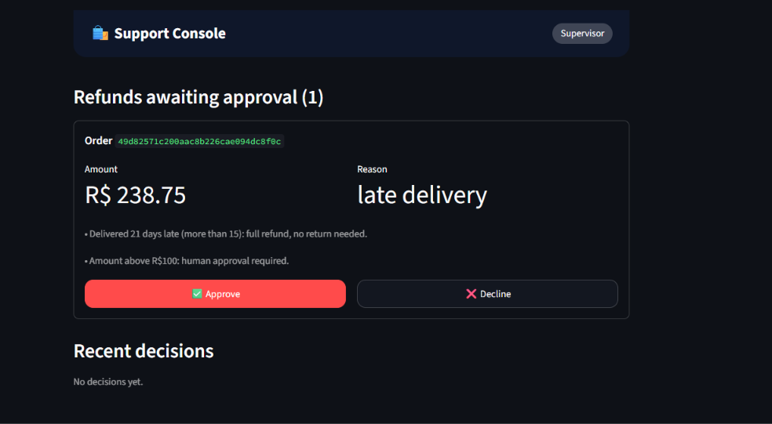
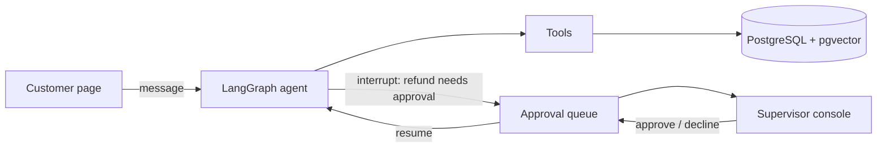

# Customer Support Agent (LangGraph + RAG)

An AI support assistant for an online store. It answers policy questions from a knowledge base, looks up real order data, and can issue refunds under hard business rules, with a human supervisor approving the large ones.

Built on the public [Olist Brazilian e-commerce dataset](https://www.kaggle.com/datasets/olistbr/brazilian-ecommerce) (PostgreSQL). The store, "Marketly", and its return policy are fictional.





| Supervisor console | Eval run |
|---|---|
|  |  |

## What it does

- **Policy Q&A (RAG).** The policy is split into sections, embedded with `all-MiniLM-L6-v2`, and stored in PostgreSQL with pgvector. The agent retrieves the 3 closest sections and answers only from them.
- **Order tools.** Order status, delivery dates, lateness, and the signed-in customer's refund history, read from the database.
- **Refunds with rules in code.** Eligibility and the refund amount are computed by deterministic Python, not by the model. The model cannot choose or change an amount.
- **Human-in-the-loop.** Refunds over R$100, boleto payments, or customers with 3+ prior refunds pause the graph (LangGraph `interrupt`). A supervisor approves or declines on a separate page, and the conversation resumes with the decision.
- **Two web pages.** A customer site (sign in, see your orders, chat) and a supervisor console, both in Streamlit.

## Architecture



| Tool | Purpose |
|---|---|
| `search_policy` | Vector search over policy sections (cosine distance in pgvector) |
| `get_order_status` / `get_delivery_info` | Order, items, payments, delivery dates |
| `check_refund_eligibility` | Decision tree: reason, time windows, amount cap, escalation flags |
| `request_refund` | Re-runs eligibility itself, then records the refund; pauses for a human when required |
| `get_my_refunds` | Refund status for the signed-in customer (identity comes from the session, not the model) |

## Safety design

- **Least privilege.** The agent connects as a database role that can `SELECT` everything and `INSERT` only into `refunds`. It cannot update or delete anything.
- **No model-controlled amounts.** `request_refund` takes only an order ID and a reason. The amount comes from `check_refund_eligibility`.
- **Bound SQL parameters** everywhere; no string-built queries.
- **The approval step cannot be skipped by the model.** The decision enters only through the graph's resume call.
- **Simulated date.** The dataset ends in 2018, so "today" is a setting (`SIMULATED_TODAY`).

## Evaluation

`python eval_support.py` runs scripted conversations as a real customer and checks the database, not just the replies.

- **Behaviour: 10/10** (policy answer, order lookup, refund approved/declined by a human, refuses an inflated R$500 request, auto-approves a small return, rejects an order past 90 days, unknown order, refund status in a new conversation, out-of-scope question).
- **Retrieval: top-1 9/10, top-3 10/10** over 10 customer-style questions.

The model is live, so an occasional run can differ in wording; re-run before assuming a bug.

## Setup

Requirements: Docker Desktop, Python 3.13, an Anthropic API key, and the Olist tables loaded into PostgreSQL (see my [AI SQL Analyst](https://github.com/VenkatChalamallaaaaaa/ai-sql-analyst) project for the loader).

```powershell
# 1. Database with pgvector (database name: olist)
docker run -d --name sqlagent-db -e POSTGRES_PASSWORD=admin -e POSTGRES_DB=olist `
  -p 5432:5432 -v sqlagent-data:/var/lib/postgresql/data pgvector/pgvector:pg16

# 2. Load the Olist CSVs into it (loader from the AI SQL Analyst project)

# 3. Python environment
python -m venv .venv
.venv\Scripts\activate
pip install -r requirements.txt

# 4. Settings
copy .env.example .env      # then add your ANTHROPIC_API_KEY

# 5. Refunds table, support role, pgvector extension
Get-Content setup_db.sql | docker exec -i sqlagent-db psql -U postgres -d olist

# 6. Embed the policy into the database
python ingest_policy.py

# 7. Run
streamlit run app.py
```

Open `http://localhost:8501` for the customer site and `http://localhost:8501/supervisor` for the supervisor console (use two browser tabs).

## Project structure

```
agent.py              LangGraph agent: model, tools, system prompt, graph
support_tools.py      All tools and business rules
customer_data.py      Read-only data for the customer page (demo sign-in, order list)
app.py                Customer site (Streamlit)
pages/supervisor.py   Supervisor console
shared.py             In-process approval queue between the two pages
ui.py                 Shared page styling
ingest_policy.py      Chunk, embed and store the policy
policies/             Fictional return policy (the knowledge base)
setup_db.sql          Refunds table and least-privilege role
eval_support.py       Behaviour + retrieval evaluation
check_tests/          Early debugging scripts for individual tools
screenshots/          Images used in this README
```

## Limitations and next steps

- **Demo sign-in.** The dataset has no real accounts, so the sign-in picks a customer from a list. A real deployment needs real authentication.
- **Order ownership is not yet enforced in every tool.** The signed-in customer ID is available to tools; the order tools should reject orders that belong to someone else.
- **Approval queue is in memory.** It works because both pages run in one server process. Production needs a database-backed queue and checkpointer so approvals survive restarts and scale across servers.
- **"Approved" records a decision only.** No real payment is made.
- **Refund-count rule** counts all past approved refunds, not just the last 90 days.
- **Retrieval** uses exact vector search over 9 sections. At larger scale: an HNSW index, hybrid (keyword + vector) search, reranking and metadata filters. The one top-3 (not top-1) result in the eval is the kind of query hybrid search would help.
- **Larger eval set** and a regression run on every change.

## Tech

LangGraph, LangChain, Claude (Anthropic), PostgreSQL + pgvector, sentence-transformers, SQLAlchemy, Streamlit, Docker.